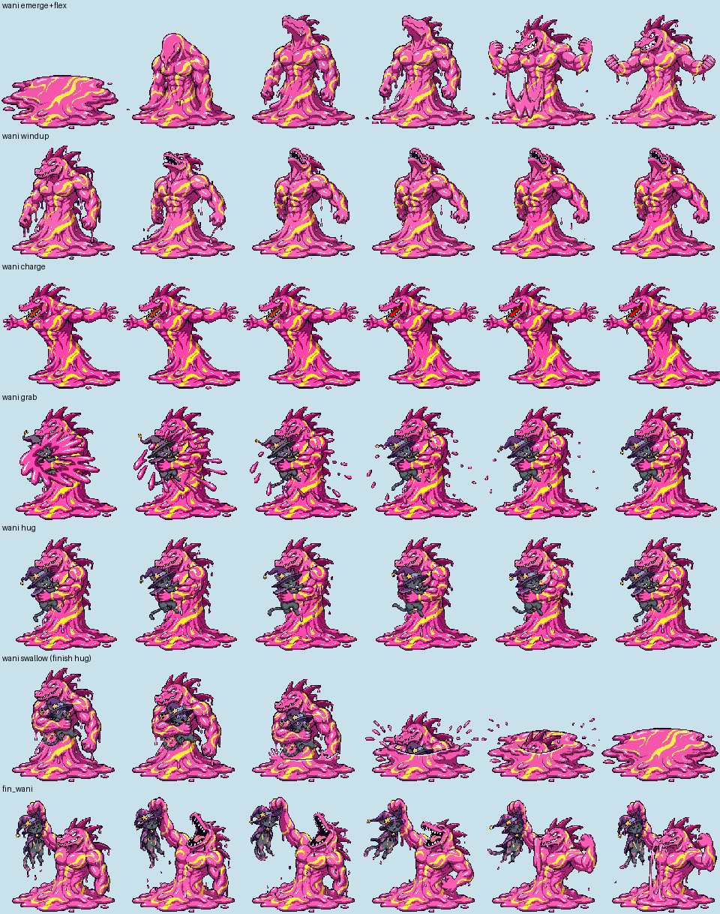
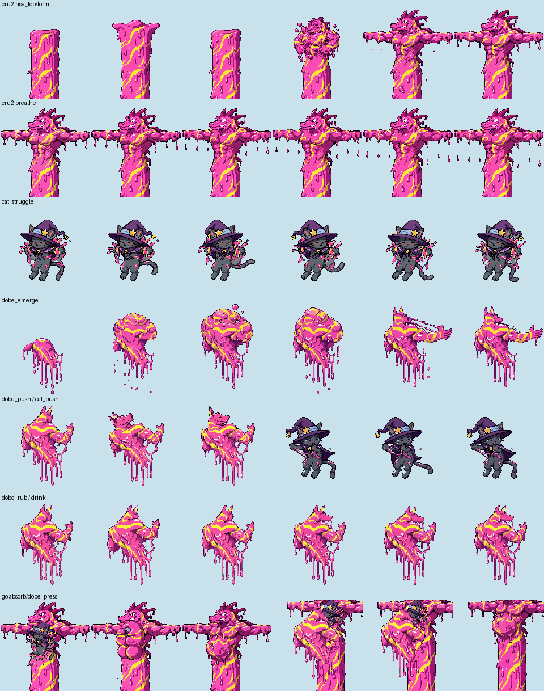
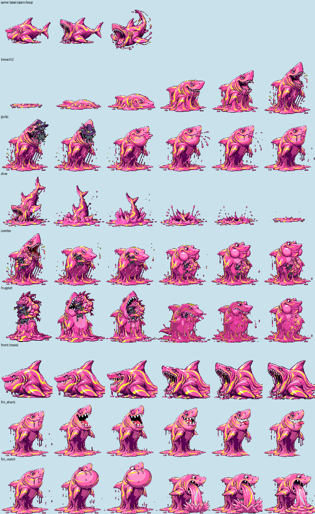
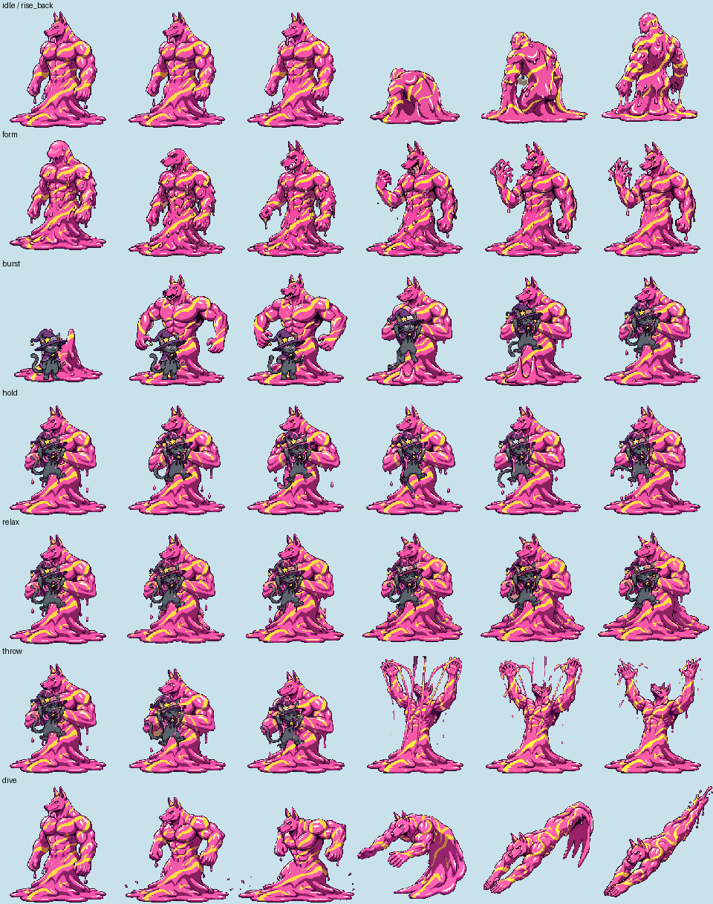
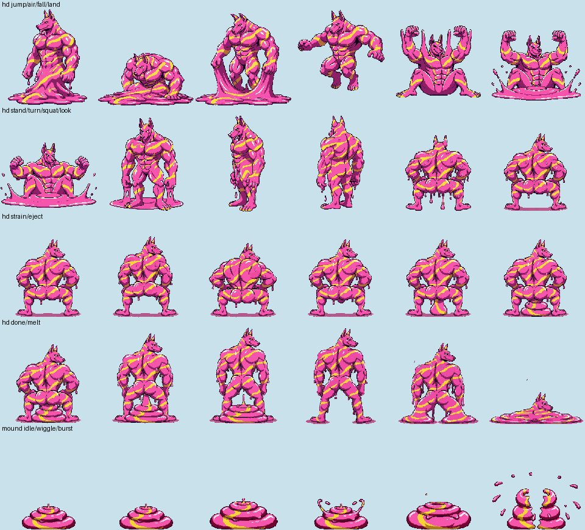
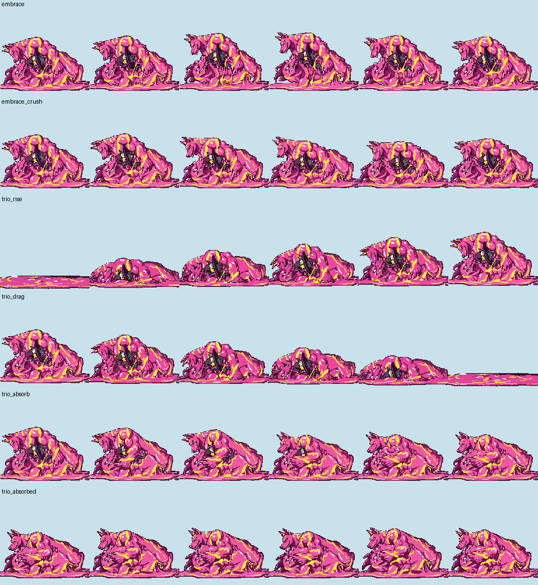

# 敵の解説（やってくる攻撃）

コード（`enemy.gd` / `shark.gd` / `doberman.gd` / `player.gd` / `main.gd` / `finisher.gd`）と `assets/` の絵から読み取った、2026-11-15 時点（コミット 427200b）の内容です。数値はコードの値で、調整すると変わります。食い違ったときはコードが正です。

各章の一覧画像（`docs/img/`）は、`assets/` のアニメから代表のコマを抜き出して並べたものです。並びは左から右へ時間順で、行の左上の文字はファイル名の頭（`wani_charge` → `assets/wani_charge_0..5.png`）です。

---

## 0. 共通の仕組み

### 見た目の共通点
- 主人公：魔女の帽子（星の飾り）とマントの黒猫。`assets/cat_*.png`（128×128、右向きが基準）。
- 敵：どれも**ピンクの体に黄色のマーブルの筋**が流れる、ドロドロの粘液でできたマッチョな魔物。足元は水たまりにつながっていて、床から生えたり溶けて潜ったりする。絵は256×256（磔の縦長だけ256×400）。

### 主人公の体力と汚れ
- HP は 250（`player.gd` の `HP_MAX`）。0 でゲームオーバー。**HP と汚れは別**。
- 汚れ：当たった場所がピンク×黄のマーブルで塗られる（`dirt.gdshader` ＋汚れマスク）。汚れるほど足が遅くなり、受けるダメージも増える。
- 受けるダメージ＝素の値 ×（捕まっている間 0.3／それ以外 0.6）×（1＋0.25×汚れ率）。長く弄ばれるように、拘束中はかなり減りにくくしてある。
  - 以下に書く「ダメージ」は全部この**素の値**。
- 拘束中の状態：`grabbed`（ワニの抱きつき）／`held`（ドーベルマンの羽交い締め）／`crucified`（磔）／`swallowed`（地中・腹の中）／`engulfed`（尻・とぐろの中）／`pinned`（地面で上下から挟まれる）。

### 抵抗ゲージ（脱出）
- 捕まると抵抗ゲージ（0〜1）が出る。**左右を交互に押す**（マウスなら左右に振る、スマホは連打）たびに増え、何もしないと毎秒減る。満タンで脱出。
- 増え方・減り方は拘束の種類ごとに違う（各敵の章に表で書く）。

### 主人公の対抗手段
- モップ（Z）：前方の床のペンキを消し、敵を押し返す。ワニの溜め中に当てると攻撃をキャンセルできる。
- 自分を拭く（X 長押し）：その場で止まるかわりに汚れが少しずつ落ちる。
- ジャンプ：ワニの殴り・突進は跳べば避けられる。ただし**潜っているワニの泡の上を跳ぶと磔**にされる。

### 床のペンキ
- 敵が歩いた跡・攻撃の跡に床のペンキが残る。踏むと足が遅くなり、足元から汚れていく。厚いほどヌルヌル滑る。
- 勢いがついた状態で急に切り返す・止まる、ふらふらで着地する、などで**転ぶ**（`slipped`）。転ぶとダメージ3と汚れ。転んでいる間はワニの殴りでも掴まれる。

### 攻撃権と難易度
- 攻撃権トークン（`main.request_token`）：同時に攻撃に入れる敵は1体だけ。
- 難易度 `main.ramp()`：開始から120秒で 0→1。ワニの潜行・サメの泳ぎの速さや狙いの遅れが序盤だけ手加減されている。

### 出てくる順番（`main.gd`）
| 敵 | 出現 |
|---|---|
| ペンキワニ | 最初から1体（x=760） |
| ペンキドーベルマン | 開始1秒後（地中に潜伏した状態で出る） |
| ペンキサメ | 開始9秒後 |

---

## 1. ペンキワニ（`enemy.gd`）



上から：登場（水たまり→形成→マッスルポーズ）／抱きつきの溜め／両腕を広げた突進／捕まえる瞬間／抱きつき（締め付けループ）／抱えたまま水たまりに沈む（地上の負け）／地中で負けた後に見せびらかす。

### 見た目と性格
- ピンク×黄マーブルのワニ頭の巨漢。胸板が厚く、背中にトゲ状のたてがみ。下半身は床の水たまりにつながっている。元絵は左向き。
- 正面から挟み撃ちに来る近接型。主人公を抱きしめて汚し、そのまま床の中へ引きずり込む。

### ふだんの動き
- 登場：水たまりから形成 → マッスルポーズ（約2.6秒）→ 戦闘開始。
- 主人公から約95px離れた「挟み撃ちの位置」に回り込む（相方がいればその反対側）。奥行きも合わせてくる（奥・手前にずらせば外せる）。
- 足元から0.5秒ごとにドロドロが広がり、動いた跡にもナメクジのようにペンキが残る。
- モップで叩かれると0.5秒怯んで押し返される。溜め中なら攻撃が止まる。

### 攻撃1：殴り（40%）
| 段階 | 内容 |
|---|---|
| 溜め | 0.5秒、少し縮む |
| 突進 | 0.35秒、280px/秒。届く距離60px、奥行き24px以内、高さ70未満（跳べば避けられる） |
| 命中 | ダメージ8、汚れ（半径2）を4か所、吹き飛ばし。後ろの壁にもペンキが飛ぶ |
| 転んでいる主人公 | 殴りではなく**掴んで抱きつき**に移る |
| 空振り | 床と壁にペンキ、0.6秒の隙 |

### 攻撃2：抱きつき突進（60%・本命）
| 段階 | 内容 |
|---|---|
| 溜め | 0.85秒、後ろにググッと体重をかける（`wani_windup`）。最後の0.2秒は小刻みに震える＝来る合図 |
| 突進 | 0.55秒、両腕を広げて380px/秒（`wani_charge`） |
| 命中 | 抱きつき。衝撃で汚れ（半径3）を7か所、ダメージ6、床と壁にペンキが派手に飛び散る。勢いでジュルジュル滑ってから止まる（床のドロドロが厚いほど長く滑る） |
| 空振り | つんのめって0.9秒の隙 |

### 抱きつき（`grabbed`）
- 捕まえる瞬間 `wani_grab` → 締め付けループ `wani_hug`（ワニと猫が1枚に描かれた絵。猫の部分にだけ汚れが乗る）。
- 締め付けている間、まわりの床と壁にペンキが広がり続ける。
- 抵抗ゲージ：交互入力1回 +0.09（Z/X でも +0.04）、毎秒 −0.22。0.35秒ごとにダメージ1.5。
- 脱出できないまま **3.5〜6.5秒**たつと、抱えたまま床に沈む（1.4秒）→ 地中の引き回しへ。

### 地中の引き回し
- 主人公を抱えたまま床の下を這い回る。中は見せず、床がうねって盛り上がり、ペンキが何度も噴き上がる。
- 抵抗ゲージ：交互入力1回 +0.07、毎秒 −0.15、ダメージ1.2（サメの1人呑みと同じ扱い）。
- 脱出すると床から飛び出して逃げられ、ワニは水たまりから形成し直す。

### 攻撃3：床に潜って奇襲
- 条件：主人公が床のドロドロの上にいる、または260px以上離れているとき（初回は4秒後、以後5〜9秒ごと）。
- 登場の逆再生で床に溶ける → 床の下を移動（泡だけ見える）。ドロドロの中は速く（200px/秒）、乾いた床は遅い（70px/秒）。序盤はその半分。狙いは1.1秒→0.45秒遅れで追いかけてくる。
- 真下に0.6秒以上いる、または4.5秒たつと飛び出す（`wani_emerge` の早回し）。届けば抱きつきへ。

### 攻撃4：磔（泡を跳び越えようとした罰）


上から：柱が生える→頭が盛り上がってワニの上半身になる／磔の呼吸ループ（ネバネバが垂れる）／磔にされた猫のもがき／柱から便乗のドーベルマンが生える／押し合いっこ（ドーベルマンののけぞり・猫の押し返し）／擦りつけ・ペンキを飲ませる／ゲームオーバー（胸に取り込む・ドーベルマンが押し込む）。

- 条件：潜行中のワニの泡の上を、主人公がジャンプで越えようとした（高さ25以上、横70px以内）。
- 足元から粘液の柱が一気に生え（1.5秒）、主人公を約140px持ち上げる → 柱の頭がグチュグチュ盛り上がってワニの上半身になる（3.4秒）。ワニは腕を真横に広げた十字、主人公はその胸板に磔。
- 捕まった瞬間：汚れ（半径3）を6か所、ダメージ8。
- 磔の間：ワニはゆっくり呼吸しながらネバネバを垂らし、柱ごと左右にしなる。もがくほど荒ぶって大きく揺れ、余裕たっぷりに上を見て、3.5〜5.5秒ごとにゆっくり重く長い鼻息（フゥーン……）を吐く。上から垂れてくるので、主人公は**上の方から**汚れていく（0.3秒ごとにダメージ1.2）。
- 抵抗ゲージ：交互入力1回 +0.06、毎秒 −0.12（腕を括られているので抜けにくい）。脱出すると空中に放り出される。
- 磔の最中にドーベルマンが来ると「磔に便乗」（3章）。

### 連携
- 他の敵が主人公を掴んでいる（`hold`）間は、反対側に回り込んで0.9秒ごとに追加で汚す：汚れ（半径3）、ダメージ5、**抵抗ゲージ −0.15**。
- 抱きつき中にサメが来ると、ワニごと丸呑みにされて地中の2対1（2章）。
- 羽交い締めの近くにいると、ドーベルマンに主人公を放り投げてもらって磔（3章）。

### 負けたとき（`finisher.gd`）
| 種類 | 状況 | 演出 |
|---|---|---|
| hug | 地上（抱きつき中など）で力尽きた | 抱えたまま水たまりに沈む（`wani_swallow`） |
| wani | 地中の引き回しで力尽きた | 床から腕を出し、ドロドロの猫をトロフィーのように掲げて見せびらかす（`fin_wani`） |
| crucify | 磔で力尽きた | 胸に取り込む → ドップンと沈む → 中でグチャグチャ揺らし続ける（`assets/cru2/go_*`） |

---

## 2. ペンキサメ（`shark.gd`）



上から：閉じ口・大口・大ジャンプの1枚絵／真下から突き上げ（`same_breach2`）／1人を呑み込んで頬を膨らませる（`same_gulp`）／大ジャンプ後に頭から沈む（`same_dive`）／ワニごと呑む（`same_combo`）／ワニに抱きつかれた猫ごと下から丸呑み（`same_hugeat`）／正面で口をゆっくり開ける焦らし丸呑み（`same_front`）／腹の中で負けた後のゲップ（`fin_shark`）／2対1で負けた後にペンキを吐き出す（`fin_vomit`）。

### 見た目と性格
- ピンク×黄マーブルのサメ。ふだんは床の下を泳ぎ、背ビレだけが出ている。元絵は左向き。
- 遊撃型。距離をとって回り込み、隙を見て突っ込んで丸呑みにする。他の敵が主人公を捕まえると、連携で決めに来る。

### ふだんの動き（回り込み）
- 主人公の左右どちらか約230pxを並走し、ときどき反対側へ回る。泳いだ跡にはペンキがはっきり残る。
- 攻撃の間隔：5秒→2.5秒（難易度で縮む）＋0〜1.5秒。

### 攻撃1：すれ違いざまの丸呑み
| 段階 | 内容 |
|---|---|
| 溜め | 一瞬止まってヒレを小刻みに震わせる（0.55秒→0.3秒） |
| 突っ込み | 主人公の**0.3秒先の位置**を通り抜けるように突進（210→330px/秒、ドロドロの中は1.15倍） |
| 命中 | 口が主人公の真下（横22px・奥行き18px以内）に来たら、真下から突き上げて丸呑み（`same_breach2` → `same_gulp`） |
| 外れ | そのまま走り抜けて離れ、0.8秒後に回り込みへ戻る |

### 攻撃2：大ジャンプでドボン
- 遠いとき（330px超、または200px超で30%）に使う。
- 1秒かけて高さ240の弧を描き、**跳んだ瞬間の主人公の位置**に落ちてくる（動けば外せる。着地点には影が出る）。
- 着地点から70px以内なら丸呑み。外れても頭からドボンと沈む（`same_dive`）。

### 呑まれた後（地中の引き回し）
- 呑まれた瞬間に全身ドロドロ、ダメージ6。
- 床の下をゆっくり蛇行しながら引き回す。見せ方は2通り：腹の中の小窓（`belly_view.gd`）で見せる（1人のとき60%）／見せずに床を突き破ってペンキが噴き出すだけ。2対1・3対1は必ず小窓。
- 抵抗ゲージ：

| 状況 | 入力1回 | 毎秒 | ダメージ |
|---|---|---|---|
| 1人 | +0.07 | −0.15 | 1.2 |
| ワニと2対1 | +0.05 | −0.2 | 1.0 |
| ワニ・ドーベルマンと3対1 | +0.035 | −0.26 | 0.9 |

- 脱出すると床から飛び出す。サメは1.2秒怯み、4秒は攻撃しない。

### 連携1：ワニごと丸呑み（地中の2対1）
- 主人公がワニに抱きつかれていると、一直線に真下へ来る（速さ1.3倍、狙いも正確）。
- 背後から大口で突き上げ、抱きしめられた猫ごとゆっくり丸呑み（`same_hugeat`、約3.2秒）→ 頬を膨らませて沈む。
- 腹の中ではワニが猫を抱えたまま、2対1で汚し続ける。

### 連携2：焦らし丸呑み（ドーベルマンの羽交い締め）
- ドーベルマンが羽交い締めにしていると、主人公の**向いている先158px**に頭だけ浮上し、こちらを向く（`same_front`）。
- 3.2秒かけて汚い口をゆっくり開けていく（ゴポゴポ音がだんだん速くなる）。この間に羽交い締めを振りほどけば、口を閉じてばつが悪そうに沈む。
- 間に合わなければ**2匹まとめてバクン** → 口を閉じてゴクン → 2匹を抱えたまま床に沈み、引き回しへ。

### 連携3：とぐろごと丸呑み
- ドーベルマンのヒップドロップで「とぐろ」に閉じ込められた主人公が**3秒以上**もがいていると、とぐろごと丸呑みにしに来る。

### 負けたとき
| 種類 | 状況 | 演出 |
|---|---|---|
| shark | 1人で腹の中で力尽きた | 床から顔を出してゲップ、帽子だけペッと吐き出す（`fin_shark`） |
| duo | ワニと2対1で力尽きた | 地中でとどめ → ゲロのようにペンキを吐き出し、その山からワニだけが余裕で形成されてポーズ（`fin_vomit`）。3対1ならドーベルマンも別の水たまりから形成される |

---

## 3. ペンキドーベルマン（`doberman.gd`）



上から：待機・水たまりから背中向きに起き上がる（登場）／振り向いて頭→目ができる形成／床から飛び出して羽交い締め（`dobe_burst`）／羽交い締めで揺らす（`dobe_hold`）／サメが来たら寛ぐ（`dobe_relax`）／ワニが来たら真上に放り投げる（`dobe_throw`）／3対1へ頭から飛び込む（`dobe_dive`）。

### 見た目と性格
- ピンク×黄マーブルのドーベルマン頭の巨漢。ワニより胸板が広く、柔らかそうなマッチョ。黄色い虹彩の人間っぽい目、ふだんは口を閉じて口角を少しだけ上げたニヤけ顔。いたずら好き。
- **待ち伏せ型**。直接は追いかけず、床の下の一点に潜んで、真上を通ったら飛び出して捕まえる。捕まえたら他の敵が来るのを待って連携する「つなぎ役」。

### ふだんの動き（潜伏）
- 床の下でじっと待つ（止まっている間はほぼ見えない。動くときだけ床がかすかに盛り上がる）。
- 主人公が他の敵に追われている：逃げる先140〜200pxへいつの間にかワープして待つ（前方にいないときだけ）。
- 追われていない：6〜10秒ごとに主人公の進む先120〜220pxへこっそりワープして待つ。
- 6〜11秒ごとにその場で顔を見せてから潜る（主人公のすぐそばでは出ない）。
- 放したあと潜ってから少しの間は飛び出さない。

### 攻撃1：飛び出して羽交い締め（`held`）
- 条件：主人公が真上（横30px・奥行き22px以内）を地上で通った。**追われていてもいなくても**飛び出すので、うっかり踏めば捕まる。
- 床から一気に飛び出して、脇の下から腕を回して首の後ろで組む本物の羽交い締め（`dobe_burst` → `dobe_hold`）。
- 羽交い締め中はねっとり揺らし、もがくとグラグラ大きく揺らし返す。
- 抵抗ゲージ：交互入力1回 +0.075、毎秒 −0.16。0.3秒ごとにダメージ0.8。
- **誰も来なければ放さない**。他の敵が来ると連携：

| 来た敵 | 連携 |
|---|---|
| サメ | 羽交い締めのまま寛ぐように姿勢を低くする（`dobe_relax`）→ サメの焦らし丸呑み（2章の連携2） |
| ワニ | ワニが床に潜る → 主人公を真上に放り投げる（`dobe_throw`）→ 真下のワニが粘液の柱で磔（1章の攻撃4）→ ドーベルマンは潜って「磔に便乗」へ |

### 攻撃2：ヒップドロップ（ギャグ寄りの拘束）


上から：溜め→大ジャンプ（粘液だまりから人らしい下半身が抜ける）→空中で正面を向いて腕を上げ足を広げる→尻から着地／立ち上がる→振り返って背中を見せる→蹲踞→首だけ振り向く／ふんばる→とぐろをひり出す／出し切って立ち上がる→溶けて地中へ／残された粘液のとぐろ（待機・もがきで蠢く・破裂）。

- 条件：顔見せのときに、主人公が110〜560px先にいる（10〜22秒に1回）。
- 立ち絵からググッと溜めて大ジャンプ → 空中で主人公の真上へ寄る → 尻から急降下 → ベチャァッと着地。
- 命中：尻で取り込む（ダメージ5）→ 立ち上がって振り返り、蹲踞 → 首だけ振り向く → ふんばる → ニヤけ顔のまま、粘液のとぐろに包んでミチミチとひり出す → 本体は溶けて地中へ。
- 外れ：近く（120px以内）なら衝撃で汚れる → 立ち上がって潜る。
- 抵抗ゲージ（`engulfed`）：

| 段階 | 入力1回 | 毎秒 | 備考 |
|---|---|---|---|
| 尻の中（立ち上がって振り向くまで） | +0.07 | −0.2 | ここで満タンにすれば尻から抜け出せる |
| 尻の中（それ以降） | 増えない | −0.2 | ほとんど抗えない |
| とぐろの中 | +0.06 | −0.12 | もがくととぐろがネチャネチャ蠢く。満タンで破裂し、転んだ状態で出てくる |

- 0.28秒ごとにダメージ0.9。とぐろの中で3秒以上もがいているとサメがとぐろごと丸呑みにする。とぐろの中で力尽きると、とぐろがときおり蠢き続ける（専用のとどめ演出なし）。

### 連携1：磔に便乗（ワニの磔にいるとき）
1章の磔の画像を参照。
- 磔の真下へ急いで向かい、柱の横から粘液が盛り上がって、猫に**背中をこちらに向けて**抱きつく姿勢で生える（`cru2/dobe_emerge`）。下半身は柱にくっついたまま。猫は軽く怯える。
- **押し合いっこ**：もがいている間だけ、抱きしめ⇄のけぞりを止まらずに繰り返す（`cru2/dobe_push`）。猫は手首の粘液から手を抜き、顔を背けて弱々しく押し返す（`cru2/cat_push`）。
  - 入力1回で押し返しゲージ +0.07（毎秒 −0.3）、同時に柱からも少し抜ける（抵抗 +0.015）。
  - 押し返しゲージが満タン → **押されたフリ**：大げさにのけぞって薄ら笑い → すぐ戻って、さっきより強く押しつける（汚れ、ダメージ2）。フリは1〜3回。
  - フリを使い切る、または5秒押し返さずに放っておく → 抵抗失敗。がっちり抱きしめる（ダメージ3）。
- **抵抗失敗後**：次の2つを3.5秒ずつ交互に（抵抗せずに抱きしめられた場合はずっと飲ませる）。
  - 擦りつけ（`cru2/dobe_rub`）：体を擦りつけて汚す。猫は目をつぶって首を振る（`cru2/cat_refuse`）。ダメージ1.2。
  - ペンキを飲ませる（`cru2/dobe_drink`）：鼻先をすぼめて猫の口に重ね、ゴクゴク流し込む。後ろから見ているので口は見えない。猫は喉だけ動き、体が不規則にビクッと震える（`cru2/cat_drink`）。ダメージ0.6＋顔まわりの汚れ。
  - 振りほどいても（入力1回 +0.03）押し合いっこに戻るだけで放さない。磔から抜けることはできる（遅め）。
- 負けたとき：抱きしめたまま柱へ押し込んで、一緒に溶け込む（`cru2/go_dobe_press`）→ ドップンと沈む → 中でグチャグチャ。

### 連携2：3対1（地中の2対1への飛び込み）


上から：締め上げ（`embrace`）／押しつぶし（`embrace_crush`）／挟まれた姿のまま地面から湧き出る（`trio_rise`）／挟んだまま溶けて地中へ戻る（`trio_drag`）／負けたとき取り込む（`trio_absorb`）／取り込んだまま抱き潰し続ける（`trio_absorbed`）。

- 主人公がサメの腹の中でワニと2対1にされて2秒以上たつと、やたら綺麗なフォームで頭から飛び込んでくる（`dobe_dive`）。
- 腹の中：寝かせた向きの挟み込み。下にワニ、上からドーベルマンがのしかかり、間に猫が埋もれる。締め上げ3周：押しつぶし2周（1周1.25秒）。
- 3対1の抵抗ゲージは2章の表の通り（いちばん抜けにくい）。
- 抜けても、吐き出された先で**地面で上下から挟まれる**（`pinned`）。挟まれた姿のまま地面から湧き出てくる（2.2秒）。
  - 抵抗ゲージ：交互入力1回 +0.08、毎秒 −0.12。0.2秒ごとにダメージ1.5（上からぐりぐり押しつけられる）。
  - 6〜10秒ごとに半々で、挟んだまま溶けて沈み、地中の3対1へ引きずり戻す。主人公だけが外に出る場面は無い。
- 負けたとき：寝そべった姿勢のまま、ドーベルマンがワニに腕を回して抱き寄せ → 押しつけて密着 → 猫がドプンと完全に沈む（約3秒）→ 抱き潰し続ける（終わらない）。

### 負けたとき（ドーベルマンが主役のもの）
| 状況 | 演出 |
|---|---|
| 羽交い締め中に力尽きた | 専用の絵はまだ無く、ワニの地上の負け（hug）を流用 |
| 地面の挟み込みで力尽きた | 上の `trio_absorb` → `trio_absorbed` |
| 磔に便乗中に力尽きた | `go_dobe_press` → 沈む → グチャグチャ |
| 3対1（腹の中）で力尽きた | サメの duo の演出で、ワニと一緒にドーベルマンも吐き出される |

---

## 4. 連携の流れ（まとめ）

```
ワニの抱きつき ──(3.5〜6.5秒)──→ 地中の引き回し（ワニ）
      │
      └─ サメが来る ─→ ワニごと丸呑み（地中の2対1）
                           │
                           └─ ドーベルマンが飛び込む ─→ 3対1（腹の中）
                                                            │ 抜ける
                                                            ↓
                                              地面で上下から挟み込み ⇄（6〜10秒ごと半々で）地中へ戻す

潜行ワニの泡を跳び越える ─→ 磔 ─ ドーベルマンが来る ─→ 磔に便乗（押し合いっこ → 擦りつけ ⇄ 飲ませる）

ドーベルマンを踏む ─→ 羽交い締め ─┬ サメが来る ─→ 焦らし丸呑み（2匹まとめて）─→ 地中の引き回し
                                  └ ワニが来る ─→ 放り投げ ─→ 磔 ─→ 磔に便乗

ヒップドロップ ─→ 尻で取り込み ─→ とぐろ ─(3秒以上もがく＋サメ)─→ とぐろごと丸呑み
```

## 5. 未実装・保留（ドーベルマンの資料より）
- 羽交い締め中の負けの専用演出。
- 棺桶（コンセプト未定）。
- 鼻の吸い込み（新しい敵のアイデアとして保留）。
- のけぞり時のドーベルマンの顔まわりの画質（今は作り直さない）。
